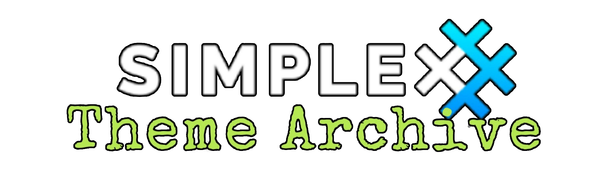
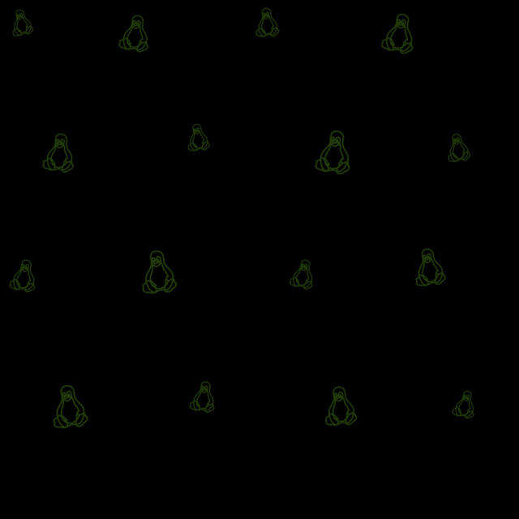

# Dark Green+

* Download [Dark Green+](../themes/SxC_darkGreen+.theme)

### Wallpaper preview



The app repeats this Tux pattern and applies the theme's existing green tint.

[Wallpaper source: SVG](../wallpapers/linux-tux-pattern.svg) · [PNG asset](../wallpapers/linux-tux-pattern.png)

----
### Theme Properties
```
base: "BLACK"
colors:
  accent: "#ffa5df19"
  accentVariant: "#ff1a5a32"
  secondary: "#ff1c8f1d"
  secondaryVariant: "#ff184908"
  background: "#ff000000"
  menus: "#ff051e0e"
  title: "#ff1f8c4b"
  accentVariant2: "#ffffb300"
  sentMessage: "#ff0e2010"
  sentReply: "#ff456a20"
  receivedMessage: "#ff000000"
  receivedReply: "#ff0c3517"
wallpaper:
  scale: 0.7
  scaleType: "repeat"
  background: "#ff000000"
  tint: "#ff31560d"
```

* [Return Home](../)
