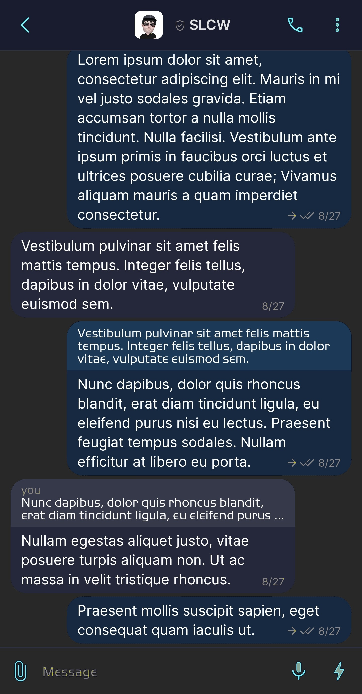
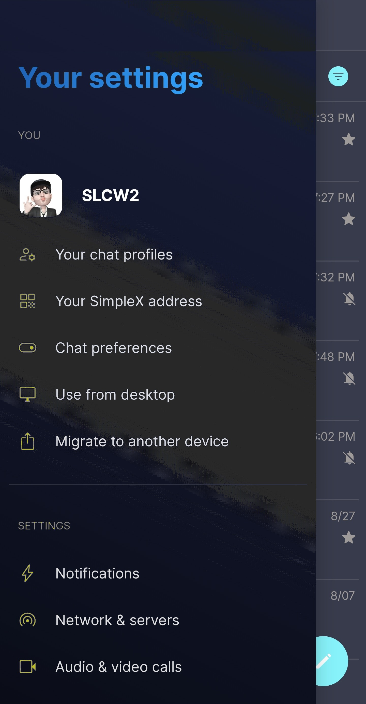
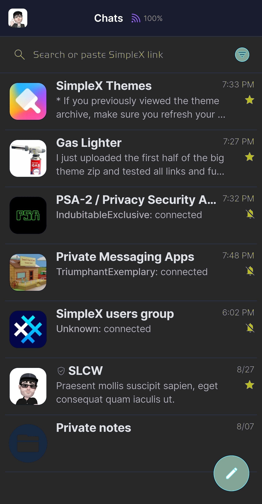
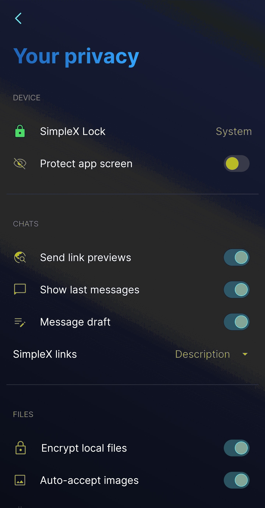

# Gruvbox Dark 1

* Download [Gruvbox Dark 1](../themes/SxC_gruvbox_dark_1.theme)

<a href="../screenshots/SxC_gruvbox_dark_101.jpg" target="_blank">
        
</a>&nbsp;&nbsp;&nbsp;
<a href="../screenshots/SxC_gruvbox_dark_102.jpg" target="_blank">
        
</a>
<br>
<a href="../screenshots/SxC_gruvbox_dark_103.jpg" target="_blank">
        
</a>&nbsp;&nbsp;&nbsp;
<a href="../screenshots/SxC_gruvbox_dark_104.jpg" target="_blank">
        
</a>

----
### Theme Properties

```
base: "BLACK"
colors:
  accent: "#ff83a598"
  accentVariant: "#ff458588"
  secondary: "#ffb8bb26"
  secondaryVariant: "#ff3c3836"
  background: "#ff282828"
  menus: "#ff1d2021"
  title: "#ffebdbb2"
  accentVariant2: "#ff458588"
  sentMessage: "#ff3c3836"
  sentReply: "#ff504945"
  receivedMessage: "#ff32302f"
  receivedReply: "#ff45403d"
wallpaper:
  scale: 1.0
  scaleType: "fill"
  background: "#ff282828"
  tint: "#00ffffff"
```

* [Return Home](../)
