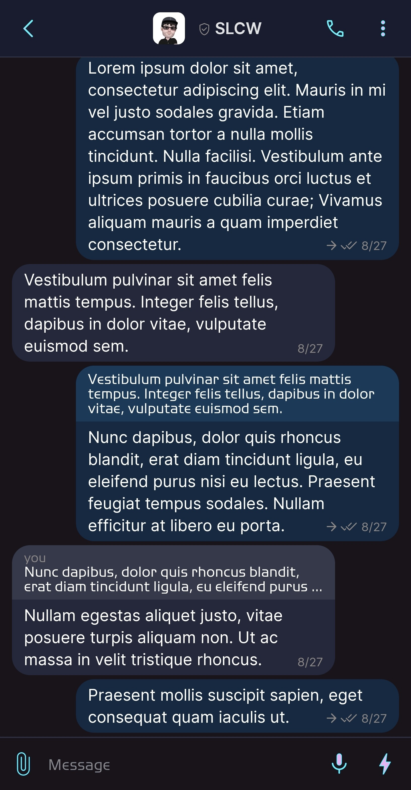
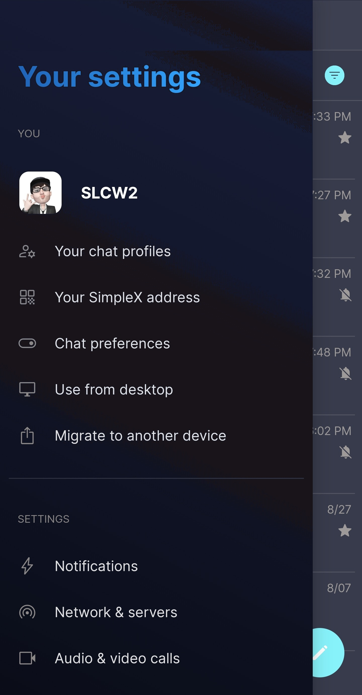
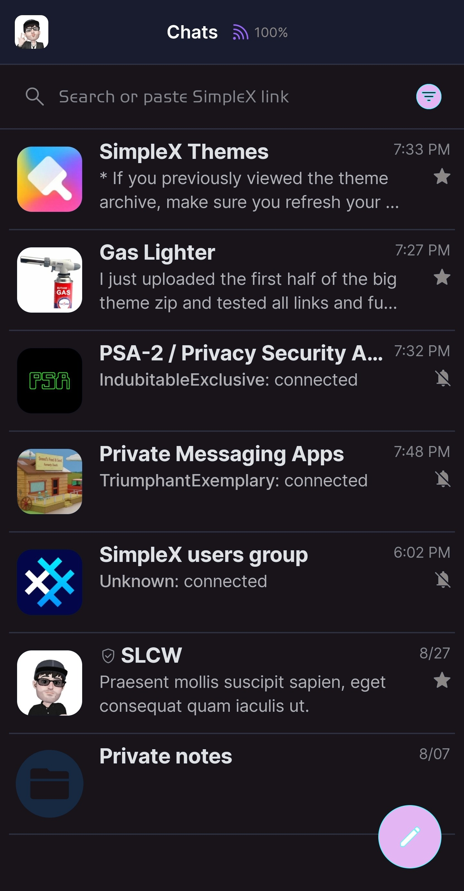
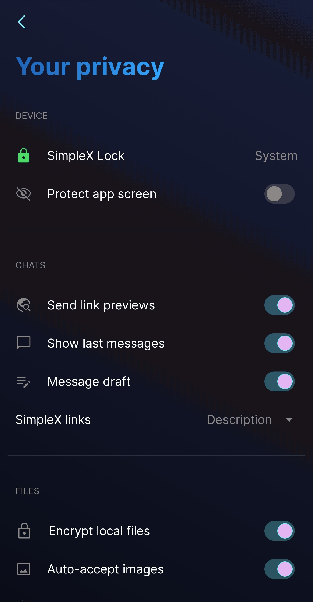

# Just Purple SxC 1

* Download [Just Purple SxC 1](../themes/just_purple_SxC_1.theme)

<a href="../screenshots/SxC_just_purple_SxC_101.jpg" target="_blank">
        
</a>&nbsp;&nbsp;&nbsp;
<a href="../screenshots/SxC_just_purple_SxC_102.jpg" target="_blank">
        
</a>
<br>
<a href="../screenshots/SxC_just_purple_SxC_103.jpg" target="_blank">
        
</a>&nbsp;&nbsp;&nbsp;
<a href="../screenshots/SxC_just_purple_SxC_104.jpg" target="_blank">
        
</a>

### Wallpaper preview

<a href="../wallpapers/just_purple_SxC_1-wallpaper.jpg" target="_blank">
        
</a>

----
### Theme Properties

```
base: "BLACK"
colors:
  accent: "#ffe3b6f3"
  accentVariant: "#ffe3b6f3"
  secondary: "#86e3b6f3"
  secondaryVariant: "#2ee3b6f3"
  background: "#ff181419"
  menus: "#ff181419"
  title: "#ffe3b6f3"
  accentVariant2: "#fff3e3f3"
  sentMessage: "#ff2a242f"
  sentReply: "#ff352b3c"
  receivedMessage: "#ff2a242f"
  receivedReply: "#ff352b3c"
wallpaper:
  scale: 1.0
  scaleType: "fill"
  background: "#ff181419"
  tint: "#00ffffff"
```

* [Return Home](../)
